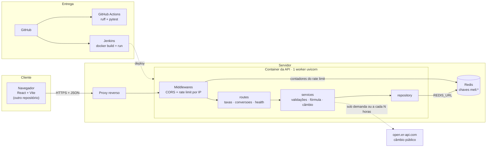
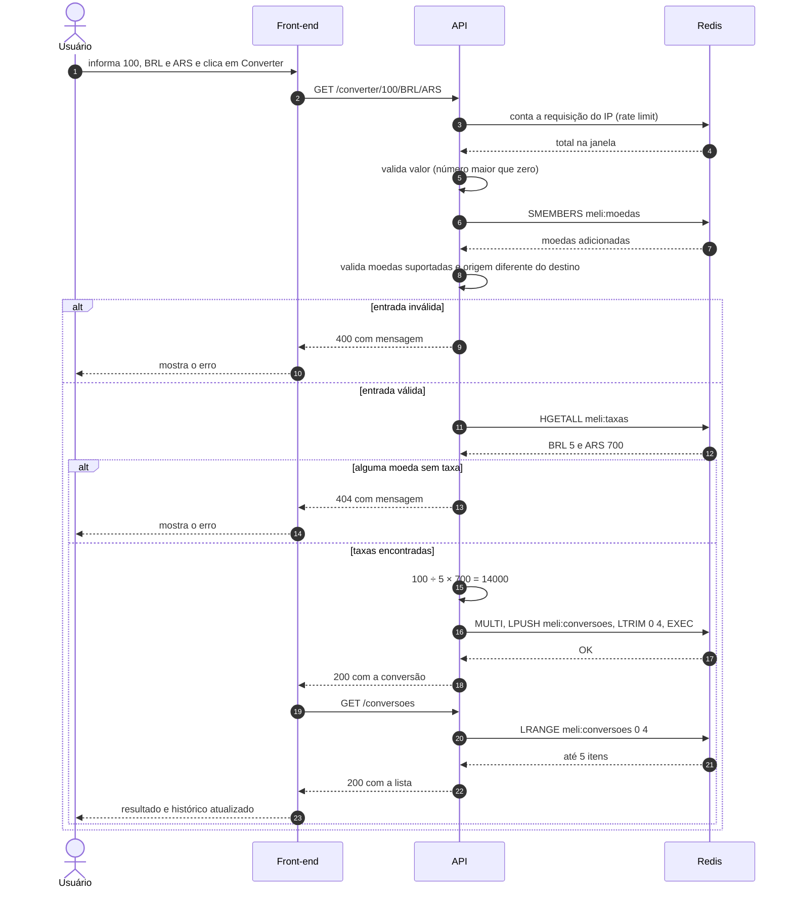
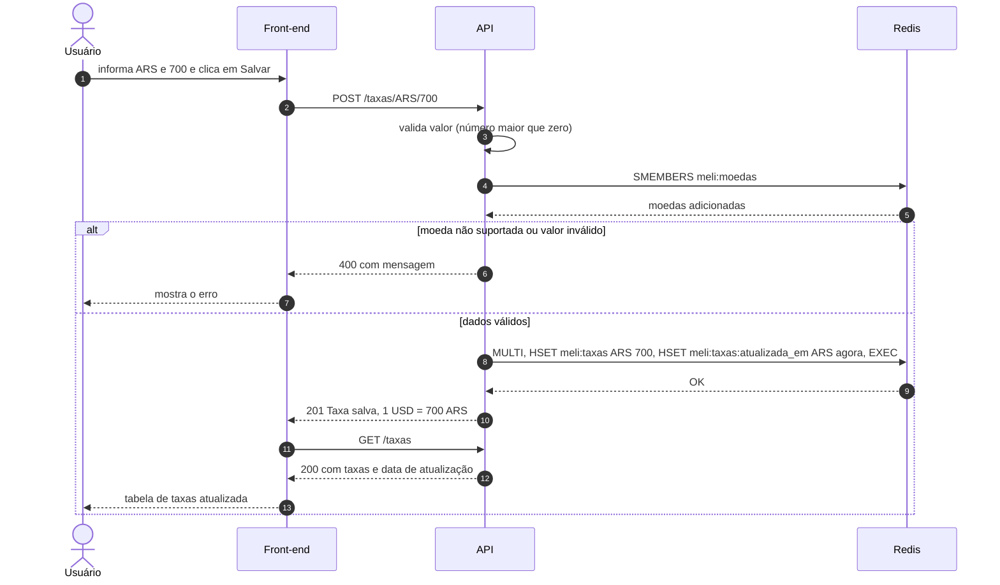
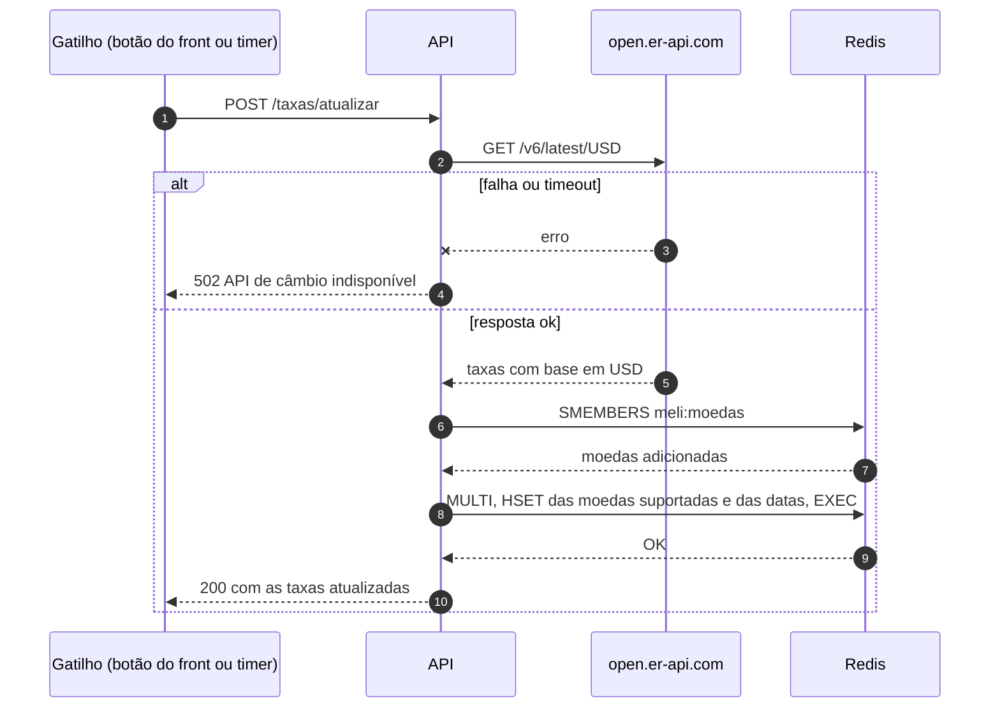

# Conversor de Moedas

API em Python que converte valores entre moedas usando o dólar (USD) como base, com as taxas guardadas em um banco chave-valor (Redis).

## 1. Requisitos funcionais

| # | Requisito |
|---|---|
| RF1 | Cadastrar a taxa de uma moeda (quanto vale 1 USD); se já existir, atualiza |
| RF2 | Converter um valor entre duas moedas pela fórmula `valor ÷ taxa da origem × taxa do destino` |
| RF3 | Toda conversão bem-sucedida entra no histórico |
| RF4 | Listar as 5 conversões mais recentes, da mais nova para a mais antiga |
| RF5 | Listar moedas e taxas, para o front-end montar as listas sem valores fixos no código |
| RF6 | Devolver erros com o status HTTP correto e uma mensagem clara |
| RF7 | Cadastrar uma nova moeda suportada sem mexer no código |
| RF8 | Guardar e expor a data e hora da última atualização de cada taxa |
| RF9 | Atualizar as taxas a partir de uma API pública de câmbio |

## 2. Requisitos não funcionais

| Tema | Decisão |
|---|---|
| Exatidão | Cálculo em `Decimal` arredondado para 2 casas (`ROUND_HALF_UP`) |
| Consistência | Escrita do histórico atômica (`LPUSH` + `LTRIM` em `MULTI`). As taxas de uma conversão são lidas em um único comando. Atualização de taxa é last-write-wins |
| Desempenho | Todas as operações no Redis são O(1) ou O(n). Meta: p95 abaixo de 100 ms |
| Disponibilidade | Alta disponibilidade (24/7) |
| Durabilidade | A do Redis usado. No `docker-compose` ele roda com AOF e volume |
| Segurança | Nenhum segredo no repositório: a URL do Redis vem de variável de ambiente. CORS restrito às origens do front-end. Rate limit por IP, contado no Redis. Validação estrita de entrada. A API não tem login, então o cadastro de taxa é aberto |
| Testabilidade | `pytest` + `fakeredis`: os testes não usam Redis real nem rede |

## 3. Estimativas

O tráfego real de uma demonstração é de dezenas de requisições. Para dimensionar, o cenário hipotético é o de uma fintech com **500 usuários por dia fazendo 10 conversões cada, ou 5.000 conversões por dia**.

| Métrica | Conta | Resultado |
|---|---|---|
| Requisições HTTP por dia | 5.000 × 2 (converter + recarregar o histórico) + 500 × 2 (carga da página) | ~11.000 |
| Média e pico (10×) | 11.000 ÷ 86.400 | 0,13 req/s e ~1,3 req/s |
| Comandos Redis por conversão | `SMEMBERS` + `HGETALL` + `LPUSH` + `LTRIM` + `LRANGE` do histórico + 2 do rate limit (1 por requisição) | 7 |
| Comandos Redis por mês | (5.000 × 7 + 500 × 6) × 30 | ~1,1 milhão |
| Armazenamento das taxas | ~100 B por moeda; 3 moedas ou as 160 moedas ISO | ~0,3 KB ou ~16 KB |
| Armazenamento do histórico | 5 itens × ~95 B, constante por causa do `LTRIM` | ~0,5 KB |
| Contadores do rate limit | até 60 entradas × ~50 B por IP ativo, expirando em 2 janelas | ~3 KB por IP ativo |
| Banda por dia | 11.000 × ~0,5 KB | ~5,5 MB |

Conclusões:

- **Capacidade não é o problema.** Um worker uvicorn atende centenas de requisições por segundo nessa carga, contra um pico de ~1,3. Os dados cabem em menos de 2 MB, mesmo com centenas de IPs ativos ao mesmo tempo.
- **O limite relevante é a cota de comandos de um Redis gerenciado gratuito.** Com 500 mil comandos por mês, o teto fica em ~2.400 conversões por dia. Um Redis próprio não tem essa cota.
- **O rate limit vale para todos os workers**, porque é contado no Redis. A atualização automática roda dentro do processo; com ela ligada, a API deve ter 1 worker, para o job não rodar em duplicidade.
- O rate limit de 60 requisições por minuto por IP permite ~30 conversões por minuto por pessoa pela tela.

## 4. Entidades

| Entidade | Campos | Regras |
|---|---|---|
| **Moeda** | `codigo` | 3 letras, sempre em maiúsculas (`brl` vira `BRL`). Suportadas = `USD`, `BRL` e `ARS` + as adicionadas pela API |
| **Taxa** | `moeda`, `valor`, `atualizada_em` | `valor` é quanto vale 1 USD e deve ser maior que zero. As taxas ficam só no Redis, inclusive a do USD, que é a base e só aceita o valor 1 |
| **Conversão** | `valor`, `moeda_origem`, `moeda_destino`, `convertido` | Guardada no histórico com exatamente esses 4 campos |

Modelo no Redis:

| Chave | Tipo | Conteúdo |
|---|---|---|
| `meli:taxas` | HASH | `ARS → 700`, `BRL → 5` (decimal como texto) |
| `meli:taxas:atualizada_em` | HASH | `ARS → 2026-10-11T15:00:00+00:00` |
| `meli:moedas` | SET | moedas adicionadas pela API (`EUR`, `CLP`...) |
| `meli:conversoes` | LIST | até 5 JSONs, com a mais nova na cabeça |
| `meli:guard:rate_limit:rate:{ip}` | ZSET | requisições do IP na janela; criada pelo fastapi-guard e expira sozinha |

## 5. Endpoints

**Obrigatórios**

| Método e rota | Sucesso | Erros |
|---|---|---|
| `POST /taxas/{moeda}/{valor}` | `201` `{moeda, valor, atualizada_em, mensagem}` | `400` moeda não suportada, valor não numérico ou ≤ 0, USD diferente de 1 |
| `GET /converter/{valor}/{moeda_origem}/{moeda_destino}` | `200` `{valor, moeda_origem, moeda_destino, convertido}` | `400` valor inválido, moeda não suportada ou origem igual ao destino · `404` moeda sem taxa |
| `GET /conversoes` | `200` lista com até 5 conversões | `404` histórico vazio |

**De apoio**

| Método e rota | Sucesso | Erros |
|---|---|---|
| `GET /taxas` | `200` `[{moeda, valor, atualizada_em}]` de todas as moedas suportadas, com `valor: null` nas que ainda não têm taxa | — |
| `POST /moedas/{codigo}` | `201` `{moeda, mensagem}` (idempotente) | `400` código fora do formato de 3 letras |
| `POST /taxas/atualizar` | `200` lista das taxas atualizadas pelo câmbio real | `502` API de câmbio indisponível |
| `GET /health` | `200` `{status: ok}` | `503` Redis fora do ar |

Em todas as rotas:

- Erros de validação e de regra saem como `{"detail": "mensagem"}`.
- `429` quando o IP passa do rate limit e `503` quando o Redis está fora do ar. Os dois vêm do middleware como texto puro, com o cabeçalho `Retry-After`.

Ordem de validação em `/converter`: valor → moedas suportadas → origem diferente do destino → taxas cadastradas. Assim cada erro tem um único caminho.

Duas decisões que evitam bugs:

- `valor` é recebido como texto e validado pela expressão `\d{1,15}(\.\d{1,8})?`. Tipar como `float` faria o FastAPI devolver `422` em vez de `400` e aceitaria `nan`, `inf` e `1e5`.
- Os números saem no JSON sem casas desnecessárias: `14000`, e não `14000.0`.

## 6. Arquitetura

Camadas do código: `routes` cuida do HTTP e da documentação, `services` concentra as regras e `repository` é o único módulo que fala com o Redis.

## 7. Diagramas de sequência

### Converter um valor

### Cadastrar ou atualizar uma taxa

### Atualizar as taxas pela API pública

O timer é opcional e fica desligado por padrão (`ATUALIZACAO_AUTOMATICA_HORAS=0`), porque ele sobrescreve as taxas cadastradas à mão pelo câmbio real.
