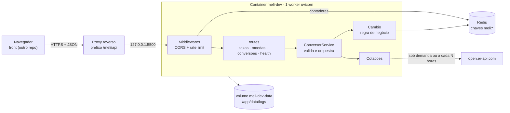
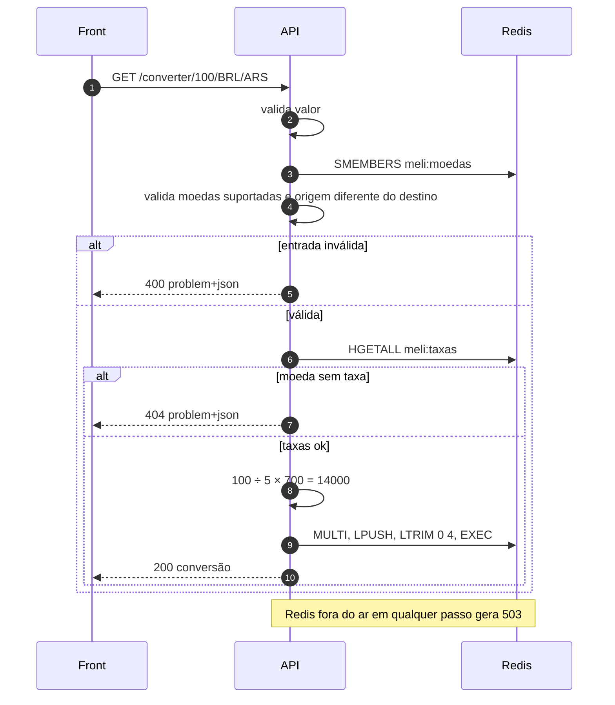
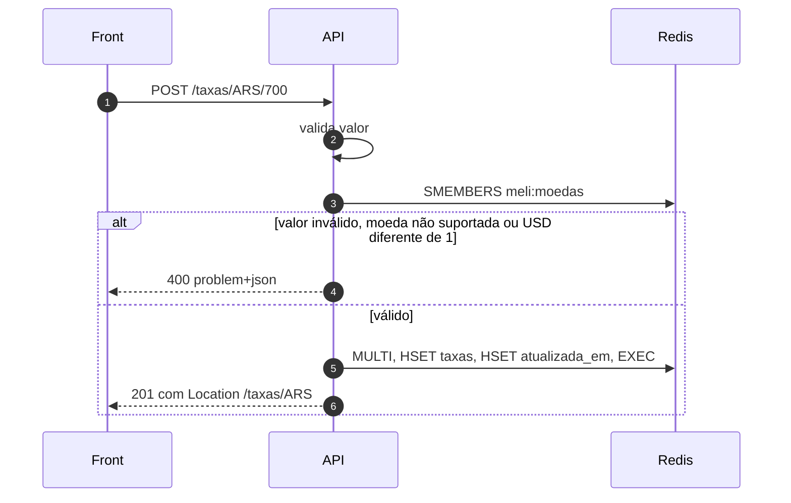
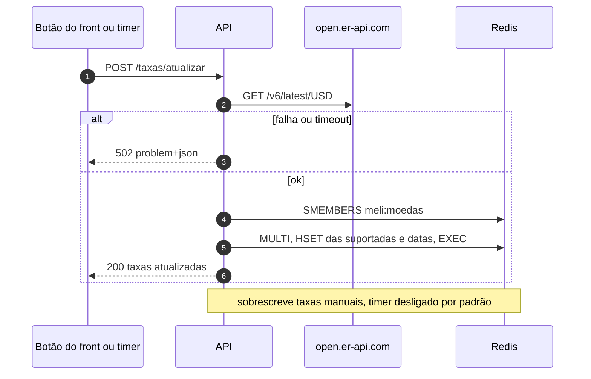

# System design

Veja também: [requisitos.md](requisitos.md) (o quê e regras) e [api.md](api.md) (contrato HTTP).

## 1. Arquitetura



| Componente | Responsabilidade | Arquivo |
| --- | --- | --- |
| `Api` | Monta o FastAPI: middlewares, handlers de erro, routers, static, timer | `backend/main/app.py` |
| `Settings` | Toda a configuração em grupos pydantic, env `GRUPO__CAMPO` | `backend/main/settings.py` |
| `Logs` | stdout + arquivo rotativo | `backend/main/logs.py` |
| routes | HTTP e documentação (Swagger) | `backend/main/routes/` |
| `ConversorService` / `ApiError` | Valida entrada, orquestra, gera problem+json | `backend/main/conversor_service.py` |
| `Cambio` | Fórmula, taxas, moedas e histórico no Redis | `backend/main/cambio.py` |
| `Cotacoes` | Busca o câmbio real em open.er-api.com | `backend/main/cambio.py` |
| Redis | Taxas, moedas, histórico, rate limit | externo |

## 2. Estimativas

Cenário hipotético: fintech com 500 usuários/dia × 10 conversões = **5.000 conversões/dia**.

| Métrica | Conta | Resultado |
| --- | --- | --- |
| Requisições/dia | 5.000 × 2 (converter + histórico) + 500 × 2 (página) | ~11.000 |
| Média e pico (10×) | 11.000 ÷ 86.400 | 0,13 e ~1,3 req/s |
| Comandos Redis por conversão | `SMEMBERS` + `HGETALL` + `LPUSH` + `LTRIM` + `LRANGE` + 2 do rate limit | 7 |
| Comandos Redis/mês | (5.000 × 7 + 500 × 6) × 30 | ~1,1 milhão |
| Taxas | ~100 B por moeda; 3 ou 160 moedas | ~0,3 KB ou ~16 KB |
| Histórico | 5 × ~95 B, constante pelo `LTRIM` | ~0,5 KB |
| Rate limit | até 100 entradas × ~50 B por IP ativo | ~5 KB por IP |

Conclusão: capacidade não é problema (1 worker atende centenas de req/s). O limite real é a cota de um Redis gerenciado gratuito (~500 mil comandos/mês ≈ 2.400 conversões/dia). Um Redis próprio não tem essa cota.

## 3. Modelo no Redis

| Chave | Tipo | Conteúdo |
| --- | --- | --- |
| `meli:taxas` | HASH | `ARS → 700`, `BRL → 5` (decimal como texto) |
| `meli:taxas:atualizada_em` | HASH | `ARS → 2026-10-25T12:00:00+00:00` |
| `meli:moedas` | SET | moedas adicionadas (`EUR`...) |
| `meli:conversoes` | LIST | até 5 JSONs, mais nova na cabeça |
| `meli:guard:rate_limit:rate:{ip}` | ZSET | requisições do IP na janela (fastapi-guard, expira sozinha) |

## 4. Fluxos

### Converter



### Cadastrar taxa



### Atualizar pelo câmbio



## 5. Decisões de eficiência

| Decisão | Alternativas | Custo | Veredito | Fonte |
| --- | --- | --- | --- | --- |
| Redis HASH/SET/LIST | SQL (Postgres/SQLite) | SQL exige schema e migração para 3 coleções pequenas | Redis: O(1)/O(n), já usado no rate limit | [Redis data types](https://redis.io/docs/latest/develop/data-types/) |
| Histórico com `LPUSH`+`LTRIM` em `MULTI` | Tabela + `ORDER BY ... LIMIT 5`; ZSET | Sem `LTRIM` a lista cresce | Tamanho constante e atômico | [LTRIM](https://redis.io/docs/latest/commands/ltrim/) |
| `Decimal` | `float` | `float` erra em base 10 (`0.1 + 0.2`) | `Decimal` + `ROUND_HALF_UP` | [decimal](https://docs.python.org/3/library/decimal.html) |
| `valor` como texto + regex | `float` no path | FastAPI devolveria 422 e aceitaria `nan`, `inf`, `1e5` | Regex `\d{1,15}(\.\d{1,8})?` | — |
| Rate limit no Redis (fastapi-guard) | Em memória; no proxy | Memória não vale entre workers | Redis, compartilhado | [fastapi-guard](https://github.com/rennf93/fastapi-guard) |
| Erros em problem+json | `{"detail": ...}` simples | Alguns campos a mais | Padrão; mantém `detail` para o front | [RFC 9457](https://www.rfc-editor.org/rfc/rfc9457) |
| Timer dentro do processo | cron externo | Exige 1 worker | Aceito enquanto 1 worker basta | — |

## 6. Organização do código

```
backend/
  main/
    settings.py           # Settings e grupos (api, log, redis, rate_limit, cotacoes, cambio)
    app.py                # class Api; único lugar que faz Settings()
    logs.py               # class Logs
    conversor_service.py  # ApiError + ConversorService
    cambio.py             # Cambio (regra + Redis) e Cotacoes (open.er-api.com)
    routes/               # taxas, moedas, conversoes, health
  tests/                  # test_api, test_cambio (fakeredis, sem pytest)
  .env.example
```

Camadas: routes → `ConversorService` → `Cambio` (+ Redis). Cada classe recebe o grupo de config no construtor.

## 7. Implantação

- Jenkins (`Jenkinsfile`): `docker build -t meli-dev .` e `docker run` com `--env-file` da credencial *Secret file* `meli-env`, `--restart unless-stopped`, `--add-host host.docker.internal:host-gateway` e volume `meli-dev-data:/app/data`.
- Porta `127.0.0.1:5500 → 8000`: só o proxy alcança.
- O proxy publica em `/meli/api`; o container recebe `API__ROOT_PATH=/meli/api` para o Swagger gerar as URLs certas.
- Branch `develop`: `RATE_LIMIT__HABILITADO=false`.
- O container roda como usuário `app`; `/app/data` já nasce com esse dono, e o volume nomeado herda.
- Front: se o export estático estiver em `/app/static`, a API serve em `/` (o build fica no repo do front).

| Sintoma | Causa | Correção |
| --- | --- | --- |
| `port is already allocated` | Container antigo ou outro serviço na 5500 | `docker rm -f meli-dev`; `docker ps` para achar quem usa a porta |
| `/docs` em branco atrás do proxy | Falta `API__ROOT_PATH` | `-e API__ROOT_PATH=/meli/api` |
| `PermissionError` em `/app/data/logs` | Volume criado antes, com dono root | `docker volume rm meli-dev-data` e subir de novo |
| Git Bash troca `/meli/api` por `C:/Program Files/Git/meli/api` | Conversão de caminho do MSYS | `MSYS_NO_PATHCONV=1 docker run ...` |
| Redis recusa conexão em produção | `meli-env` ainda com `REDIS_URL` | Atualizar o Secret file para `REDIS__URL` |
